  

<h2 align="center">成都理工大学宜宾校区在读学生</h2>

<h3>关于我 · About Me</h3>

平时喜欢做顺手的桌面小工具，也喜欢折腾 AE 脚本。这里记录我在做的项目和一些小实验。

<h3>一些项目 · Projects</h3>

<ul>
  <li><a href="https://github.com/PowerT-0704/EzQR-Tools"><strong>易码 EzQR-Tools</strong></a> · 桌面二维码识别与生成工具</li>
  <li><a href="https://github.com/PowerT-0704/CampusLink"><strong>CampusLink</strong></a> · 宜宾校区校园网自动连接与掉线重连</li>
  <li><a href="https://github.com/PowerT-0704/W3F7-Video-Toolsbar></strong></a>Video_Toolsbar </strong></a> · 本地录音转录 封面封装</li>
</ul>
 
